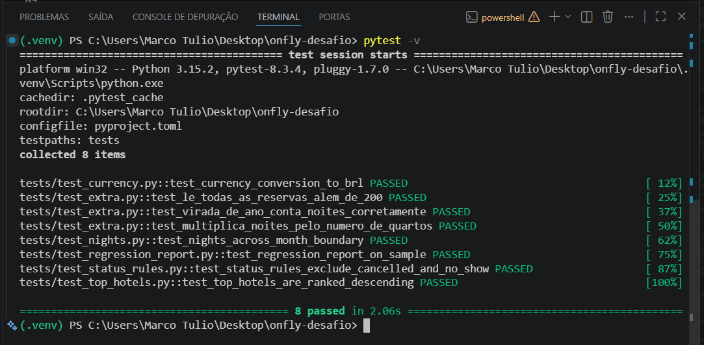

# Entrega — Consolidador de reservas Onfly

## Resumo

Encontrei e corrigi **5 defeitos** no CLI. Os 5 testes fornecidos passam sem alteração
e adicionei 3 testes novos em `tests/test_extra.py`. O relatório do arquivo real e a
amostra de validação do README batem com os valores esperados.

## Defeitos corrigidos

| # | Arquivo | Defeito | Causa raiz | Correção |
|---|---------|---------|------------|----------|
| 1 | `services/status_policy.py` | `NO_SHOW` entrava em noites e valores | A regra era "tudo que não é `CANCELLED`" em vez de "só `CONFIRMED`". | `status == "CONFIRMED"` |
| 2 | `services/report_builder.py` | `top_hotels` mostrava os hotéis de **menor** valor primeiro | A chave de ordenação usava o valor em ordem crescente. | Chave `(-amount, hotel_id)`: valor decrescente, empate por id crescente |
| 3 | `services/stay_calculator.py` | Noites negativas na virada de mês/ano (30/01→02/02 dava -28) | Subtraía só o dia do mês (`.day`) em vez da diferença entre as datas. | `(checkout - checkin).days * rooms` |
| 4 | `services/currency_converter.py` | Valores em USD/EUR muito menores que o real | Dividia pela taxa em vez de multiplicar e fazia a conta em `float`. | `amount * rate`, só com `Decimal` |
| 5 | `repositories/csv_reservation_repository.py` | O relatório ignorava as reservas a partir da 201ª | Um `if len(rows) == 200: break` interrompia a leitura do arquivo. | Removi o limite |

Observação: `average_nightly_rate_brl` também saía errado, mas a fórmula estava certa;
era consequência dos defeitos 1, 3, 4 e 5, que erravam as noites e os valores.

O defeito 5 não é pego por nenhum teste fornecido, porque todos usam poucas reservas.

## Como investiguei

Comecei lendo o README do projeto para entender as regras de negócio e identificar quais comportamentos o relatório deveria ter. Em seguida, criei o repositório `onfly-desafio` no GitHub, subi o código original na branch `main` e criei a branch `fix/corrige-relatorio` para fazer as correções, com um commit por defeito.

Ao rodar o `pytest`, vi os 5 testes falhando. A partir das mensagens de erro, abri cada arquivo envolvido para entender a lógica por trás do problema, comparando o código com a regra correspondente do README e avaliando as possibilidades de correção.

Contei com a orientação de uma IA para estudar os conceitos envolvidos (datas, `Decimal`, ordenação e testes) e revisar meu raciocínio. Os detalhes estão em `entrega/uso-de-ia/declaracao.md`.

### Mensagens de erro

Usei a saída do `pytest -v` para corrigir de forma incremental, acompanhando o placar subir de 0 a 5 testes aprovados a cada ajuste. Ler o retorno exato das falhas evitou adivinhações: o `assert -28 == 3` revelou que o cálculo de noites usava só o dia do mês, e a lista de hotéis ao contrário (`['H04', 'H03', 'H02']`) indicou que a ordenação estava crescente. Nos exercícios de estudo, aprendi a ler primeiro a última linha do traceback para resolver erros de nome (`NameError`), chaves ausentes (`KeyError`) e tipos incompatíveis (`TypeError`).

### Comparação com as regras do README

Meu método principal foi reescrever cada função do zero com base na regra do README e depois compará-la lado a lado com o código original:

- **Status:** rodei a minha versão de `is_billable` e a do projeto com os três status e constatei que o projeto considerava `NO_SHOW` faturável, contrariando a regra de que só `CONFIRMED` é faturável.
- **Noites:** simulei cenários de mesmo mês, virada de mês e virada de ano usando `.day` e `.days`. O `.day` só falhava fora do mês, o que explicava o `-28`.
- **Câmbio:** fiz a conta à mão (US$ 100 × 5,42 = 542) e notei que o projeto dividia o valor pela taxa e usava `float`.
- **Ranking:** testei a ordenação com empates e verifiquei que `reverse=True` inverteria também o critério de desempate.

### O defeito sem teste

Sabendo pela orientação que existia um defeito não coberto pelos testes, rodei o relatório no arquivo real depois dos 5 testes verdes e vi que o resumo mostrava 200 reservas para um CSV de 300 linhas. No código de leitura, encontrei um `if len(rows) == 200: break` interrompendo o loop. Para validar a correção, criei um teste com 250 reservas e fiz a prova de fogo: ele falhava com o limite e passava depois da remoção.

### Tropeços

- **Ambiente:** rodei testes fora do `.venv`, abri o terminal na pasta errada, salvei um arquivo dentro do `__pycache__` e configurei o endereço do repositório remoto errado. Isso me ensinou o hábito de ler o caminho do terminal e a mensagem de erro antes de qualquer alteração.
- **200 → 300:** minha primeira tentativa foi só trocar o número. Percebi que isso apenas mudava o tamanho do problema (um "número mágico") e removi o limite de vez.

## Testes adicionados

Em `tests/test_extra.py`:

- `test_le_todas_as_reservas_alem_de_200`: 250 reservas; protege contra o defeito 5.
  Confirmei que ele falha com o `break` de volta e passa sem ele.
- `test_virada_de_ano_conta_noites_corretamente`: 30/12/2024 → 02/01/2025 = 3 noites.
- `test_multiplica_noites_pelo_numero_de_quartos`: 3 noites × 2 quartos = 6.

## Como validar

```bash
python -m venv .venv
source .venv/bin/activate        # Windows: .venv\Scripts\activate
pip install -r requirements-dev.txt

pytest -q

PYTHONPATH=src python -m onfly_report \
  --input data/reservas_hoteis.csv \
  --rates data/taxas_cambio.csv \
  --output output/report.json
```

No PowerShell (Windows), troque o `PYTHONPATH=src` por `$env:PYTHONPATH = "src"` numa
linha separada e escreva o comando numa linha só.

Resumo esperado do relatório completo:

```
Reservas: 300 | Confirmadas: 235 | Noites: 1347 | Total BRL: 396170.00
```

Resumo esperado da amostra (`data/exemplo-validacao.csv`):

```
Reservas: 12 | Confirmadas: 9 | Noites: 28 | Total BRL: 7566.00
```

## Resultado do pytest

